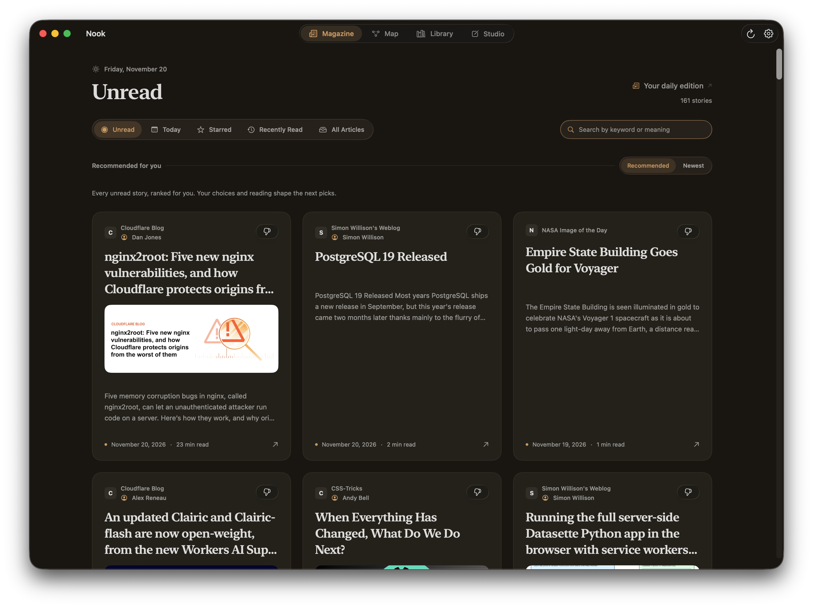
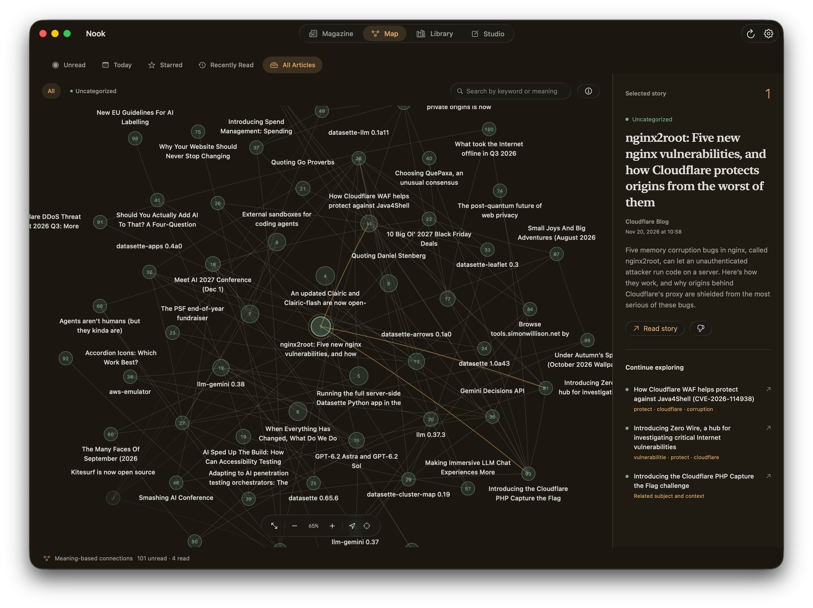
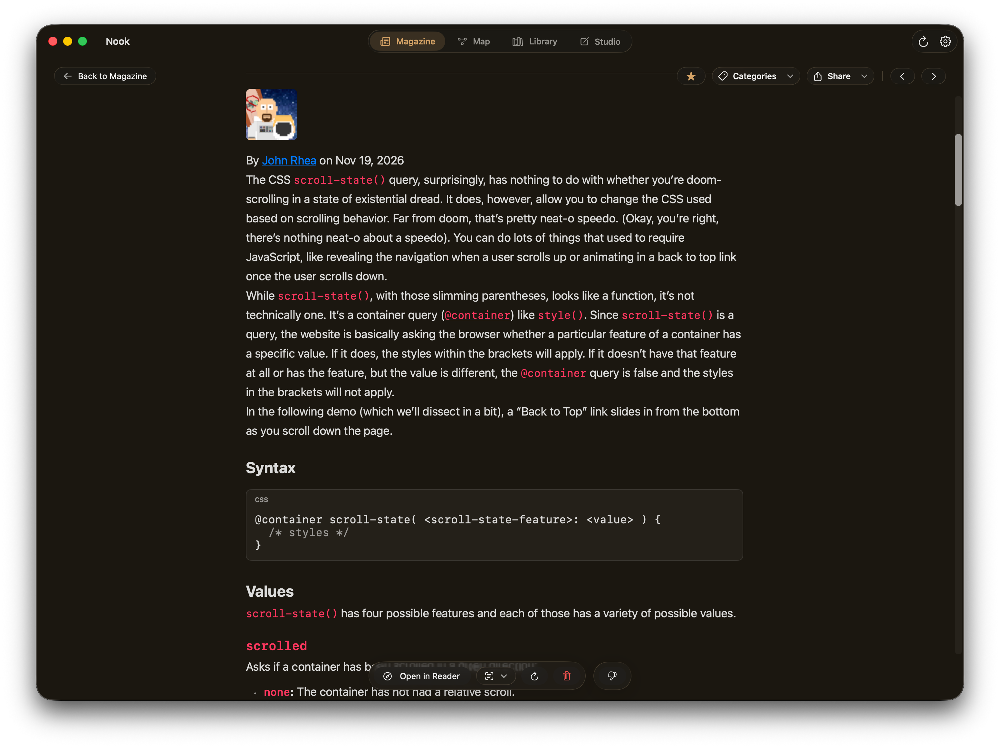
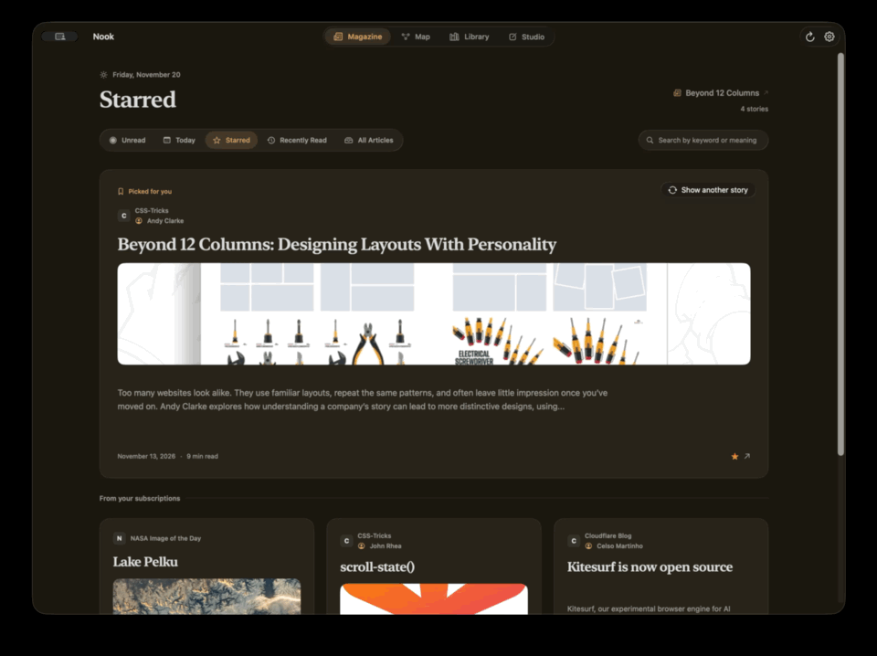
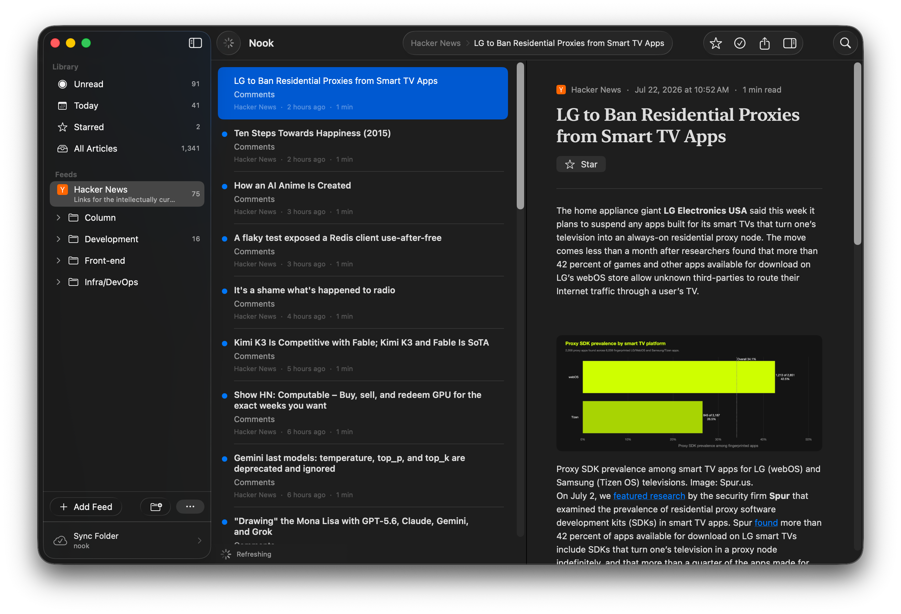
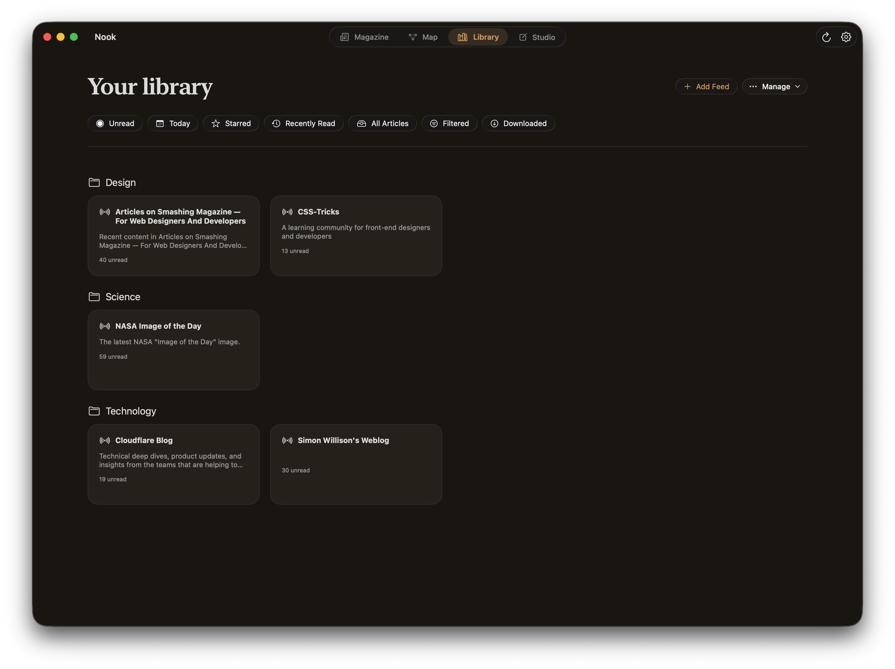

<h1 align="center">
  <br/>
  Nook
</h1>

<p align="center">A native RSS reader for Mac, iPhone, and iPad. Follow your feeds, explore related ideas, and keep your library in a folder you control.</p>

<p align="center">
  <a href="https://github.com/nooker-app/nook/releases/latest">
    
  </a>
</p>

<p align="center">
  <a href="https://github.com/nooker-app/nook/releases/latest"></a>
  
  
  
  <a href="https://github.com/nooker-app/nook/stargazers"></a>
  <a href="LICENSE"></a>
</p>

<p align="center">
  <a href="docs/screenshots/main.png"></a>
</p>

**Your feeds, with room to read.** Browse articles as a magazine, follow connections on a map, or use a traditional inbox. Reading is free and needs no Nook account.

> **New to RSS?** Follow sites, blogs, and newsletters in one place, with new posts delivered directly from the sources you choose. [Why use RSS feeds →](https://openrss.org/guides/what-are-rss-feeds#why-use-rss-feeds)

## Take a quick look

**Start in Magazine.** Move between Unread, Today, Starred, Recently Read, and All Articles. Open a card to read it; return to the collection when you are done. Unread can also show recommendations based on your reading interests.

<table>
  <tr>
    <td width="50%"><a href="docs/screenshots/map.png"></a></td>
    <td width="50%"><a href="docs/screenshots/reader.png"></a></td>
  </tr>
  <tr>
    <td valign="top"><strong>Follow an idea.</strong> Pan and zoom the Map, select a story, and explore related writing across your feeds. Search by keyword, or use natural language with the optional local models.</td>
    <td valign="top"><strong>Settle in and read.</strong> Read articles, formatted code, and links in a native surface. Star, share, translate, or open the source without losing your place in the collection.</td>
  </tr>
</table>

The main Mac screenshots show the **Beta** layout with real English-language feeds. Click a screenshot to inspect it at full size. Switch between Beta and Classic in Settings.

<details>
<summary>Watch a short walkthrough: open a story and return to Magazine</summary>

<p align="center"></p>

Recorded in the actual macOS app. The images and article text come from the selected feed.

</details>

<details>
<summary>Prefer an inbox? See the Classic layout</summary>

<p align="center"><a href="docs/screenshots/classic.png"></a></p>

Classic keeps folders, the article list, and the reader together. Both layouts use the same library, read state, and stars.

</details>

## Make it your reading space

1. **Choose a folder.** Keep the library locally, or choose a folder in iCloud Drive, Dropbox, Syncthing, or another sync service you already use.
2. **Add your sources.** Paste a website or RSS URL, or import an OPML file from another reader. Organize feeds into folders when useful.
3. **Read your way.** Catch up, star something for later, search for a half-remembered article, or explore its connections on the Map.

Want to try the sources in these screenshots? [Import this small English feed collection](docs/screenshots/feeds.opml), or [see the source list](docs/screenshots/README.md).

<details>
<summary>See feeds and folders in the Library</summary>

<p align="center"><a href="docs/screenshots/library.png"></a></p>

</details>

- **Native reading tools.** Images, code, tables, quotes, comments, and links render in the native reader. Choose typography, export Markdown, and switch between [legibility](https://github.com/nooker-app/legibility) and Readability when a page needs a different parser.
- **Find things again.** Recently Read records articles you actually opened. Search and the Map connect writing across feeds; recommendations can learn from deliberate reading choices and “Not my taste” feedback.
- **Optional translation and summaries.** Translate titles, previews, and articles, or ask for a summary. Streaming translation preserves the structure of the writing.
- **Your own organization.** Use stars, folders, manual categories, keyword rules, filters, and optional AI classification.
- **Reading widgets on Mac.** See latest, recommended, or recently read stories in small, medium, and large widgets. Select a story to open its reader directly.
- **A writing space, too.** With a Nook+ account, Studio keeps your drafts and published posts together and lets you write and publish through ATProto. RSS reading remains independent of Nook+.
- **A library you own.** Feed content stays available offline. Download full articles when needed, import or export subscriptions with OPML, and sync through your chosen folder service.

See [all features and their defaults](docs/features.md) for platform differences and individual controls.

## Local by default, AI when useful

RSS reading, keyword search, folders, and rules work without an AI provider. Translation, summaries, and AI categorization are optional. Apple Intelligence runs on supported devices; Gemini is an opt-in alternative using your own API key, with requested content sent to Google.

On Apple silicon Macs, optional models add meaning-based connections and natural-language search. They download separately and analyze articles on your Mac. Models are not bundled into the app, and Nook does not send your library to a recommendation server.

Your folder-sync service carries the library between devices. Nook merges each device's changes so reading and starring on two devices do not overwrite one another. [How storage and sync work →](docs/data-and-sync.md)

<details>
<summary>Why I built Nook</summary>

I have read RSS every day for more than ten years. In that time I paid for readers, tried most of the free ones, and kept meeting the same small frictions. The feature I wanted was behind a subscription. The app that had it was missing something else. There were bugs. Sometimes there were ads, in an app I had opened specifically to get away from ads.

What I wanted was for reading to be more than reading. I wanted to find the piece I half-remembered without going hunting for it. I wanted a foreign-language post to be legible without leaving the app. And I wanted the collection to be mine — a place I built, not a feed handed to me.

A bird builds its nest one twig at a time, and the result is entirely its own. That is the idea: gather the writing you care about into a space that fits you, keep it somewhere you control, and stop having to think about it.

So Nook tries to do three things. Make good writing easy to read. Make it easy to find again later, without having to be organized about it up front. And leave every piece of it under your control.

</details>

Nook is for people who want a native Apple-platform reader and control of their library. If you need a web or Android client, server-side collection while all your devices are offline, or extensive annotation tools, see the [RSS reader comparison](docs/reader-comparison.md).

## Install

### macOS (Homebrew)

```sh
brew install --cask nooker-app/tap/nook
```

Nook is signed with a Developer ID and notarized, so a cask install opens without a Gatekeeper prompt. It updates itself through Sparkle afterwards, which is why `brew upgrade` has nothing to do.

### macOS (DMG)

1. Download the latest [Nook DMG](https://github.com/nooker-app/nook/releases/latest).
2. Drag **Nook** into **Applications**.
3. Choose the folder where Nook should keep and sync your library.

Requires **macOS 26 (Tahoe)** or later. The universal build supports Apple Silicon and Intel. Apple Intelligence translation requires a supported Apple Silicon Mac; Gemini is optional and requires your own API key and a network connection.

### iOS / iPadOS

[Nook on the App Store](https://apps.apple.com/us/app/nook-read-write-own/id6797773158). On first launch, pick the same synced folder your Mac uses through the Files picker.

<details>
<summary>See Nook on iPhone</summary>

<p align="center"></p>

</details>

To run your own build on a device instead:

1. Open `Nook.xcodeproj` and select the **NookiOS** scheme and your device.
2. Choose your team under **Signing & Capabilities**, then press **⌘R**.
3. Through the Files picker, select the same synced folder used by your Mac.

Requires **iOS/iPadOS 18** or later. Apple Intelligence translation requires a supported device running **iOS 26**.

## Learn more

- [Features, controls, and platform details](docs/features.md)
- [Comparison with other RSS readers](docs/reader-comparison.md)
- [Data ownership, cloud sync, and conflict handling](docs/data-and-sync.md)
- [Building, architecture, and releasing](docs/development.md)
- [Homebrew tap setup](docs/homebrew-tap.md)
- [Submitting to the App Store](docs/app-store-submission.md)

## Build from source

```sh
git clone https://github.com/nooker-app/nook
cd nook
make build
```

See [development notes](docs/development.md) for the iOS build command, architecture, toolchain, and release process.

## License

[MIT](LICENSE) © 2026 Tim.
