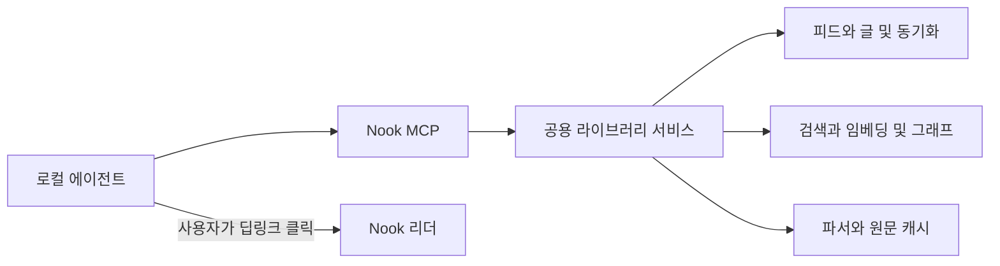

# Nook 로컬 MCP 설계안

Nook의 라이브러리, 검색, 본문 파서와 연관 그래프를 로컬 에이전트에 제공한다. 최근 소식 조사와 아이디어 발전을 돕고, 모든 결과에 원문 주소와 Nook 리더 딥링크를 함께 제공한다. MCP 구현은 후속 작업이며 아래 API와 연결 방식은 제안이다.

## 기능과 도구

| 도구 | 역할 |
| --- | --- |
| `list_feeds`, `add_feed` | 피드 조회, 폴더를 지정한 피드 추가 |
| `refresh_feeds` | 선택한 피드 갱신, 갱신 시각과 실패 상태 제공 |
| `save_article` | URL을 저장한 글에 추가, 중복 방지 |
| `list_articles` | 최신순·추천순, 기간·피드·읽음·별표 필터와 페이지네이션 |
| `search_articles` | 키워드·의미·혼합 검색, 근거와 발췌 제공 |
| `get_article` | 메타데이터, 리더 본문, 원본 HTML 조회 |
| `related_articles` | 지도 연결과 내용상 유사한 글을 구분하여 제공 |
| `index_articles`, `index_status` | 백그라운드 인덱싱, 진행률과 취소 |
| `open_article` | 사용자가 요청할 때 해당 글을 실제 리더에서 열기 |

초기 글 추가는 URL 저장을 의미한다. Nook+ 초안 작성과 발행은 별도 도구·권한으로 확장한다. 검색은 사용자 라이브러리 대상이며 웹 전체 검색이 아니다. 최신 소식 조사에서는 필요한 피드의 갱신 시각을 확인한다.

## 기존 코드 재사용

- `NookKit/Sources/NookKit/ReaderStore.swift`: `addFeed`, `saveLink`, `searchArticles`, `ensureReaderContent`, `displayedReaderParser`, 라이브러리 저장 경로.
- `NookKit/Sources/NookKit/ArticleMarkdown.swift`: `nativeReaderMarkdown`과 HTML 변환. 로딩 중 RSS 요약으로 폴백한 결과를 완전한 원문이라고 반환하지 않도록 비동기 본문 해석 서비스를 분리한다.
- `NookKit/Sources/NookKit/ArticleSearch.swift`: 공용 키워드·의미 검색. 현재 누락된 글들을 배치 인덱싱하므로 MCP 요청 하나가 전체 인덱싱을 기다리지 않게 검색 응답과 인덱싱 작업을 분리한다.
- `NookKit/Sources/NookKit/RecommendationMap`: 기존 모델·벡터·쌍 점수 캐시와 그래프 엔진을 공유한다.
- `NookKit/Sources/NookKit/ArticlePreviewCache.swift`: 원문 캐시와 피드·호스트별 요청 제한을 공유한다. 기본 간격 1초, 분당 최대 30회이며 사용자 설정과 서버 쿨다운을 존중한다.
- `Nook/LayoutSelection.swift`, `Nook/WidgetShared.swift`: 공용 URL 라우팅. 위젯용 글 딥링크 구현을 MCP에서도 재사용한다.

## 본문 계약

현재 리더 본문 또는 유효한 캐시를 우선 사용한다. 없으면 글별 파서 선택과 설정의 기본 파서를 존중하여 추출한다. 실제 사용한 파서, 원문 URL, 가져온 시각, 완전성, 폴백 여부를 반환한다. 목차·각주·표·코드·링크를 보존한 Markdown과 구조화된 데이터를 기본 응답으로 제공한다. 원본 HTML은 별도 요청으로 제공하고 큰 응답은 제한·분할한다.

Nook 네이티브 화면 자체를 MCP 텍스트로 전달할 수는 없다. 사용자는 딥링크를 통해 현재 Classic/Beta 리더에서 같은 내용을 읽는다. 채팅 내부의 시각적 UI가 필요하면 HTML 기반 MCP Apps를 별도 검토한다.

## 데이터와 실행 경계

실제 변경은 앱의 기존 저장 경로를 통한다. 별도 프로세스가 동기화 파일을 독립적으로 수정하거나 모델을 중복 로딩하지 않는다. 에이전트 조회는 읽음, 최근 읽은 글, 추천 학습을 변경하지 않는다. 사용자가 실제 리더를 열었을 때 기존 읽기 설정을 적용한다.

준비된 임베딩으로 즉시 검색하고 인덱싱 범위를 명시한다. 모델이 없으면 키워드 검색을 제공한다. 모델 다운로드는 기존 동의 절차를 유지하며 임베딩 생성은 취소 가능한 백그라운드 작업으로 수행한다. 기사 본문은 외부 데이터이며 에이전트 지시로 취급하지 않는다.

## 연결과 딥링크

공식 Swift MCP SDK 기반 앱 내 로컬 HTTP 서버와 필요한 클라이언트용 stdio 브리지를 검토한다. 사용자에게 Node/Python 설치를 요구하지 않는 네이티브 배포를 목표로 한다. SDK가 실제 지원하는 프로토콜 버전을 고정하고 대상 클라이언트와 호환성을 검증한다.

설정의 에이전트 연결에서 활성화, 연결 설정 복사, 읽기/추가 권한, 인증 폐기를 제공한다. HTTP는 localhost에만 바인딩하고 인증·Origin 검증을 적용한다. 앱이 종료된 경우의 실행 및 연결 실패 UX를 정의한다. 웹 서비스는 Mac의 localhost에 직접 연결할 수 없으므로 별도 연결 경로가 필요하다. 초기 대상은 로컬 에이전트를 우선 제안했으며 구체적인 클라이언트 선택은 미정이다.

딥링크는 라이브러리와 글을 식별하고 앱 시작·라이브러리 로딩을 기다린 뒤 현재 레이아웃의 리더를 연다. 파일 시스템 경로나 인증 정보를 URL에 포함하지 않는다. 삭제된 글과 다른 라이브러리를 명확히 안내하며 원문 HTTPS 주소도 함께 반환한다. 조회만으로 앱 화면을 열지 않는다.

로컬 MCP여도 클라우드 에이전트에 반환한 본문은 해당 모델에 전달될 수 있음을 연결 설정에 안내한다.

## 스킬과 배포

MCP는 기능 인터페이스이고 스킬·마켓플레이스는 필수가 아니다. `nook-research` 스킬 하나로 피드 갱신 확인 → 검색 → 본문 확인 → 연관 글 탐색 → 출처·딥링크 제시 흐름을 제공하는 것을 권한다. 스킬은 발행일/수집일 구분, 중복 기사 정리, 근거 없는 최신성 주장 방지를 포함한다. 마켓플레이스·Registry 등록은 발견과 설치 편의를 위한 후속 배포 작업이다.

## 검증할 항목

- 조회 전후 읽음·별표·최근 기록·추천 프로필 불변.
- Classic/Beta, 앱 종료·시작, 필터 밖 글, 삭제된 글, 라이브러리 전환 딥링크.
- 선택 파서, 캐시 파서 출처, 추출 실패 및 요약 폴백, 목차와 각주.
- 모델 없음·부분 인덱싱·대규모 라이브러리·동시 검색·작업 취소.
- 반복 호출 중복 방지, 요청 제한, 인증 폐기와 비정상 Origin.
- 지원 클라이언트별 연결·리소스·딥링크 표시 호환성.

## 공식 참고 자료

- [Swift MCP SDK](https://github.com/modelcontextprotocol/swift-sdk)
- [MCP 전송 명세](https://modelcontextprotocol.io/specification/2026-07-28/basic/transports)
- [Streamable HTTP 보안과 연결](https://modelcontextprotocol.io/specification/2026-07-28/basic/transports/streamable-http)
- [MCP Apps](https://modelcontextprotocol.io/extensions/apps/overview)
- [Agent Skills](https://agentskills.io/home)
- [MCP Registry](https://modelcontextprotocol.io/registry/about)
