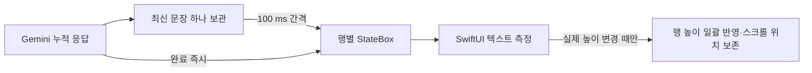

# 실시간 태그·Gemini 제목 번역 중 목록 스크롤

## 원인과 수정

Gemini 제목 스트리밍의 표시 단계가 이미 받은 문장을 최대 4글자씩, 33 ms 간격으로 다시 나누고 있었다. `ListTitleProgressEmitter.emit`가 각 표시를 기다린 뒤 반환하므로 공급자의 다음 응답 처리도 표시 속도에 묶였다. 100글자를 한 번에 받아도 25개의 중간 상태를 만들었다. 이 상태마다 SwiftUI `Text`와 `IntrinsicRevealLayout`이 다시 측정된다. 공급자 작업을 메인 액터 밖으로 옮긴 것만으로는 이 UI 비용이 없어지지 않았다.

`ListTitleTranslationWorker`는 이제 다음과 같이 동작한다.

- 공급자는 다음 누적 문장을 계속 전달하고, 표시 대기 중에는 최신 값 하나만 보관한다.
- macOS 중간 표시는 최대 100 ms에 한 번이다. iOS의 기존 90 ms 간격은 유지한다.
- 완료 결과는 즉시 표시한다. 완료·실패·취소 시 예약된 중간 표시를 해제한다.
- 응답 자체가 한 번에 끝나면 인위적인 타이핑 프레임을 만들지 않는다. 실제 응답이 진행 중일 때의 스트리밍은 유지한다.

앞선 수정도 함께 main에 반영했다.

- `ReaderStore.applyCategoryAssignments`: 배지만 달라지는 경우 전체 목록·개수 재계산 대신 카테고리 개수 증감과 행 일괄 패치. 카테고리 선택·숨김으로 목록 포함 여부가 바뀌면 기존 재필터를 유지한다. CRDT 기록과 shard 저장은 유지한다.
- `ArticleTableController.updateVisibleRows`: AppKit의 미리 준비한 행과 실제 보이는 행을 구분한다. 화면 밖으로 나간 행의 대기·진행 번역을 취소한다.
- `ScrollMotionGate`: clip view 이동 속도, 안정화 150 ms, 기본 dwell 1.5초를 사용한다. 빠른 이동은 600 pt/s 이상이며, 최근 들어온 행을 우선한다.
- `ArticleTableScrollAnchor`와 `flushHeights`: 행 높이 변경을 묶고 첫 완전히 보이는 행의 위치를 보존한다.

## 근거와 한계

Time Profiler의 메인 스레드 6,895개 샘플 중 `sizeThatFits`가 1,401개, `layoutSubtreeIfNeeded`가 1,228개, `IntrinsicRevealLayout.sizeThatFits`가 429개에 나타났다. 호출 스택은 중첩되므로 합산할 수 없다. 이 프로파일은 초기의 불완전한 850개 사본에서 얻었으며, 렌더링 경로를 찾는 근거로만 사용한다.

처음에는 `NookLibrary.json`과 사용자 상태만 복사해 동기화된 콘텐츠를 빠뜨렸다. 그 결과 850개만 로드된 측정과 두 줄 공간 예약 실험은 실제 라이브러리 검증에서 제외했다. `.nook/content`, `.nook/bodies`, `.nook/reader`까지 포함한 완전한 사본은 앱에서 **5,823개 글, 읽지 않음 2,979개, 별표 27개, 피드 24개**로 확인했다. 원본 라이브러리와 설치 앱은 변경하지 않았다.

사용자 지적대로 빠른 스크롤은 번역 시작을 억제하므로 스트리밍 렉의 검증으로 충분하지 않다. 마지막 비교는 완전한 사본에서 Gemini 직렬 큐 + 태그 600개 + **120 pt/s 느린 스크롤(L7)**을 같은 조건으로 한 번씩 실행했다. 공급자 응답만 DEBUG fake(글자당 15 ms)이며 실제 Gemini API·SSE·키체인·과금 경로는 실행하지 않았다. 일본어 대상으로 한·영 제목이 번역되게 했다. 스크롤은 실제 휠 이벤트가 아니라 앱의 clip view를 움직인 것이다.

## 전후 결과

최종 Gemini 비교의 수정 전은 `3871a82`(main의 `e2e98f1`과 동일한 기능), 수정 후는 스트리밍 병합 패치다. 최종 수치는 아래에 기록한다.

| 5,823개 글 · Gemini L7 · 각 1회 | 수정 전 | 스트리밍 병합 후 |
| --- | ---: | ---: |
| 번역 상태 갱신 | 578회 | 200회 |
| 번역 시작 / 완료 / 취소 | 10 / 10 / 0 | 18 / 18 / 0 |
| 프레임 지연 비율(hitchRatio) | 243.14 ms/s | 25.02 ms/s |
| 드롭 프레임 비율 | 21.02% | 2.34% |
| 최악의 메인 스레드 정지 | 48.51 ms | 94.13 ms |
| 100 ms 이상 정지 | 0회 | 0회 |
| 실제 활성 구간 | 30.75초 | 20.65초 |

상태 갱신은 65.4% 줄었고 더 많은 번역이 완료되었다. 프레임 지연도 감소했지만 **목표 5 ms/s는 아직 충족하지 않았다**. 최악의 단일 정지 시간은 증가했다. 시스템 부하가 통제되지 않은 단일 비교이므로 모든 체감 렉이 해결됐다는 증거로 사용하지 않는다. 드라이버는 고정 프레임 수만큼 이동하므로 같은 이동량도 놓친 콜백에 따라 실제 소요 시간이 늘어난다.

앞선 행 패치·가시성 수정의 lib-5k 원본 로그도 별도로 보존했다.

| L3 빠른 스크롤, 각 2회 | 수정 전 | 행 패치·가시성 수정 후 |
| --- | ---: | ---: |
| 목록 전체 publish | 각 23회 | 각 0회 |
| 개수 전체 재계산 | 각 23회 | 각 0회 |
| 시작 / 완료 / 취소 | 각 8 / 0 / 8 | 각 2 / 0 / 2 |
| hitchRatio | 5.65 / 3.99 ms/s | 0.83 / 37.80 ms/s |

즉, 전체 재계산과 지나가는 행의 불필요한 작업은 줄었으나 과거 기록만으로 프레임 목표를 통과했다고 결론 내릴 수 없다. 이전 인계의 “on 시나리오 통과” 주장은 채택하지 않는다. 켬·끔 기록은 같은 시나리오 ID를 쓰므로 별도 디렉터리로 집계해야 한다. `perfreport.py`의 lib-5k `Gate failures: none`은 live 목표를 검사한 결과가 아니다.

## 검증

- 단위 테스트: 공급자 코드가 UI 스레드 밖에서 실행되는지, 빠른 100개 토큰이 최신 스냅샷 하나로 합쳐지는지, bulk 결과의 즉시 완료, 수정·중복·실패·완료 시 예약 해제를 검증한다.
- macOS: `make build`.
- iOS: `xcodebuild -project Nook.xcodeproj -scheme NookiOS -destination 'generic/platform=iOS Simulator' -derivedDataPath DerivedData -skipPackagePluginValidation CODE_SIGNING_ALLOWED=NO build`.
- 제한된 전체 테스트: `perl -e 'alarm 900; exec @ARGV' swift test --package-path NookKit --no-parallel --skip 'ReaderTypographyTests|NativeInlineHTML|AnchorFlash'`.
- `plutil -lint Nook.xcodeproj/project.pbxproj Nook/Nook.entitlements`, `git diff --check`.

스트리밍 패치의 macOS·iOS 빌드와 635개 테스트가 통과했다. `live-checks/live-window-1.png`, `live-window-2.png`에서 사이드바 항목, 피드, 카테고리 배지, 번역 제목의 표시를 확인했다. 캐시된 번역만 있는 화면이 아니라 두 캡처 사이에서 다음 행의 번역도 진행했다.

사용자 요청에 따라 측정 매트릭스 반복을 중단했다. 최종 패치 이후 A/B/C/T 전체 시나리오의 성능 무회귀는 재확인하지 않았으며, 이전 수치를 이번 패치의 통과 증거로 사용하지 않는다. 이후 사용자 요청에 따라 직접 체험할 로컬 Release 진단 빌드를 추가했다. GitHub 릴리스 게시나 `/Applications/Nook.app` 교체는 하지 않는다.

## 로컬 근거

모두 main 작업 폴더의 gitignored `perf-runs` 아래에 보관한다. 사용자 라이브러리·프로파일·스크린샷은 저장소에 커밋하지 않는다.

- `live-handoff-before-tr/`, `live-handoff-after/`: 앞선 lib-5k 전후 로그.
- `live-handoff-trace-real/`: 레이아웃 호출 경로를 확인한 프로파일(850개 사본).
- `live-handoff-gemini-coalesce-before/`, `gemini-coalesce-after/`: 완전한 라이브러리의 최종 전후 비교.
- `real-fixture/golden/real-full/`: 동기화 콘텐츠를 포함한 검증용 사본.
- `live-checks/`: 최종 빌드·테스트 로그와 화면 확인.

## 실제 사용자 표시에서 찾은 셀 재사용 애니메이션

첫 Release 체험의 사용자 표시 구간에서는 목록 제목 `list.title.state` 갱신이 없었고, 대부분 50 ms 이상 정지도 없었다. 사용자는 화면 위치가 튀는 것이 아니라 스크롤이 뚝뚝 끊기는 증상이라고 확인했다.

실행 중인 Release 앱의 실제 스크롤을 Time Profiler로 12초 수집했다. 메인 스레드 3,046개 샘플 중 `RBInterpolatedDisplayListContents`가 820개(26.9%), `CGDrawingLayer.draw`가 859개, `sizeThatFits`가 417개였다. `IntrinsicRevealLayout`은 3개여서 이 구간의 주된 비용은 번역 블록 높이 계산이 아니라 텍스트 보간 렌더링이었다. 프레임 비율이 아니라 CPU 샘플 비중이며 호출 스택은 중첩된다.

`ArticleRowLayout`의 메타데이터 줄은 `.animation(value: model.categories)`를 사용했다. `NSTableView`가 동일한 hosting cell을 다른 글에 재사용하면 새 글의 카테고리 차이도 애니메이션의 트리거가 된다. 피드명·시간·태그를 포함한 줄이 다른 글로 바뀔 때 불필요한 보간 렌더링이 발생할 수 있었다.

메타데이터 하위 뷰에만 `.id(model.id)`를 지정해 글이 바뀌면 애니메이션의 이전 값을 새로 시작하도록 수정했다. 테이블 행이나 전체 셀의 ID는 바꾸지 않으므로 선택·스크롤 위치·네이티브 swipe action은 유지한다. 같은 글의 태그 추가는 하위 뷰 ID가 같아 기존 애니메이션을 유지한다. macOS 및 서명된 Release 빌드가 통과했다.

## Release 체험과 문제 기록

`make trace-build TRACE_SIGN_IDENTITY='<이 프로젝트의 Developer ID 인증서>'`는 `DerivedData-trace/Build/Products/Release/Nook.app`을 만든다. Release 최적화에 `NOOK_PERFORMANCE_TRACE`만 추가하며, DEBUG 가짜 번역·격리 라이브러리 경로는 포함하지 않는다. 인증서 없이 개발용으로 빌드할 때의 기본 서명은 ad-hoc이다. 실제 설정·보안 범위 북마크·Gemini 자격 증명으로 체험할 때는 프로젝트의 Developer ID를 사용한다.

- 도움말 → **문제 시점 기록** 또는 **⌘⌥⇧L**: `USER_MARK`와 현재 누계 기록. 확인음이 난다.
- 도움말 → **성능 로그 보기**: 해당 세션 파일을 Finder에서 표시한다.
- 50 ms 이상 메인 스레드 멈춤을 자동 기록하고, 2초마다 스크롤·번역·행 높이·태그 처리 카운터를 저장한다.
- 파일은 앱 컨테이너의 `Library/Logs/Nook/performance-<UTC 시간>-<PID>.log`에 생성한다. 세션당 현재/이전 파일을 8 MiB씩 보관한다.
- 기사 제목·본문·번역문·API 키는 기록하지 않는다. 행 번호, 길이, 처리 시간, 공급자 이름, 전체 글/피드 수, 빌드 식별자만 남긴다.
- 일반 Release 빌드에는 이 진단 코드와 메뉴가 포함되지 않는다.

진단 로그는 타이밍과 카운터 로그이며, Instruments의 전체 샘플링 스택 트레이스는 아니다. 사용자가 표시한 시각에 어떤 작업과 메인 루프 단계가 겹쳤는지 좁히는 데 사용한다.
